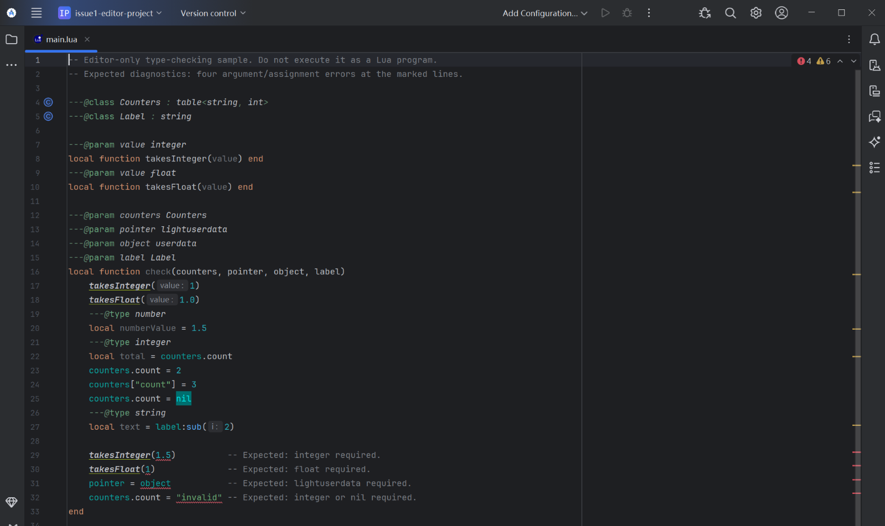
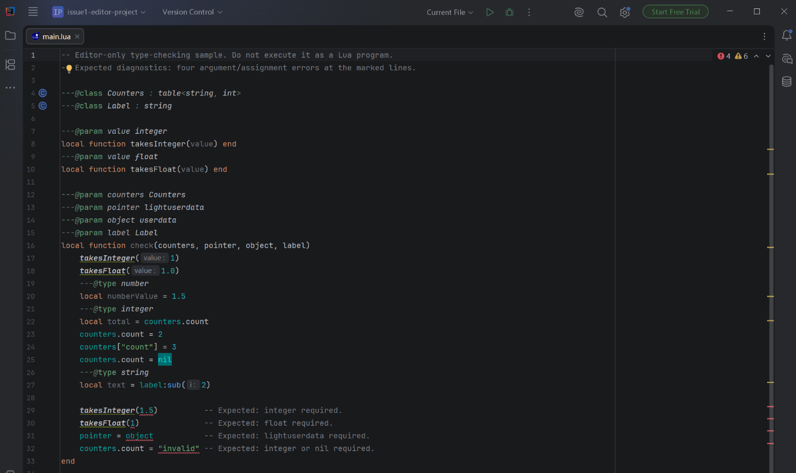

# IntelliJ-LuaInsight 1.5.6 verification

Date: **2026-11-02**. IDE display name: **Lua Insight**. Publisher: **ClarkWain**.
Source commit: `d005bc60d6855812f2b08b5e54363dd59ce006f4`.

This release fixes [issue #1](https://github.com/ClarkWain/IntelliJ-LuaInsight/issues/1):
numeric annotation subtypes, distinct `lightuserdata`, and primitive/generic-table
inheritance with inherited member/indexer inference. Review also found and fixed
an additional numeric-union composition case. Eight tests were added in total.

## Automated checks

The [CI run](https://github.com/ClarkWain/IntelliJ-LuaInsight/actions/runs/41407135034)
ran `test buildPlugin verifyPlugin` for both targets, with normal settings
search-index generation enabled.

| Platform | Scope | Result |
| --- | --- | --- |
| IDEA 2025.1.7.2 | Full suite, CI | 135/135 passed |
| IDEA 2026.1.5 | Full suite, CI | 135/135 passed |
| IDEA 2026.2.3 | Full suite, Windows editor fixtures | 135/135 passed |
| Android Studio 2025.2.3 | Original patch full suite | 134/134 passed |
| Android Studio 2025.2.3 | Refined primitive and type-safety tests | 55/55 passed |

The extra `testNumericUnionComposition` case failed before the refinement and
passed afterward. It checks that merging equal-valued unions does not retain
only one branch's integer/float representation. Existing literal-value equality
(`1` accepts `1.0`) is retained. Other coverage includes built-in registration,
serialization, generic dictionary ancestors, explicit-field precedence, nil
entry deletion, illegal overrides and the retained inheritance restrictions.
Results are recorded in [issue1-results.json](validation/issue1-results.json).

## Plugin Verifier

| IDEA SDK | Platform build | API compatibility errors |
| --- | --- | --- |
| 2025.1.7.2 | IU-251.29188.72 | 0 |
| 2025.2.6.3 | IU-252.28539.97 | 0 |
| 2025.3.6.1 | IU-253.33813.55 | 0 |
| 2026.1.5 | IU-261.27258.48 | 0 |
| 2026.2.3 | IU-262.10968.63 | 0 |

Each SDK reports one existing packaging warning: the plugin bundles the IDE
package `org.intellij.markdown`. Deprecated API usages (24–33, depending on SDK)
and 21 experimental API usages remain. Raw reports are attached to the CI run.

## Native editor checks

Source-built sandbox IDEs opened the [editor sample](../examples/issue1-validation/main.lua).
Android Studio 2025.2.3 (`AI-252.28238.7.2523.14688667`, JBR 21) and IDEA
2026.2.3 (`IU-262.10968.63`, JDK 25) each displayed exactly four expected errors:
an inappropriate float argument, an inappropriate integer argument, full
userdata assigned to lightuserdata, and a string assigned to an integer dictionary.
Valid calls, inherited integer fields, nil entry removal and a string-parent
method call had no corresponding type errors. Six ordinary unused-code warnings
are also visible in the sample.





Separate SDK diagnostics were present: Windows COM/ADB and an application-disposal
error during Android Studio shutdown, and OS Integration/WSL startup errors in the
extracted IDEA 262 SDK. These editor checks establish the observed type behavior,
not an entirely clean IDE log. Debugger sessions and C API runtime behavior were
not exercised.

## Release packages

| Package | Supported platform range | Bytes |
| --- | --- | --- |
| `IntelliJ-LuaInsight-1.5.6-IDEA2025.zip` | 251–253 | 8,906,604 |
| `IntelliJ-LuaInsight-1.5.6-IDEA2026.zip` | 261–262 | 8,907,389 |

SHA-256:

```text
cb515ec195bc6774eacb586cecc8778efbdab53ed2646cd22dac464b1b89f921  IntelliJ-LuaInsight-1.5.6-IDEA2025.zip
a3c1505ecce97696d63f3fcd0a680516be66b456fd2575ab0dc8b14d83a0093e  IntelliJ-LuaInsight-1.5.6-IDEA2026.zip
```

Archive checks confirm the expected descriptor, publisher, compatibility bounds,
new primitive declarations in Lua 5.0–5.4, previous package-string fixes, debugger
resources and settings search-index archive. Disassembly confirms stub version
**3**, which forces older indexes to rebuild for the updated literal serialization.
Details are in [release-summary.json](validation/release-summary.json).

## Remaining limits and reproduction

Arithmetic and unannotated inference retain conservative `number` widening.
Extreme numeric values, hexadecimal floats and all custom numeric alias
combinations were not exhaustively tested. The annotation subtypes do not change
Lua runtime semantics on older language levels.

Run Gradle with JDK 21; the 2026 target also needs a JDK 25 toolchain:

```sh
./gradlew test buildPlugin verifyPlugin -DIDEA_VER=2025 --no-configuration-cache
./gradlew test buildPlugin verifyPlugin -DIDEA_VER=2026 --no-configuration-cache
```

For installed IDEs, add `-PlocalIdePath=/path/to/ide`. Manual
[workflow](../.github/workflows/build.yml) runs with `validate=true` execute the
full test and verifier matrix. The [1.5.5 record](https://github.com/ClarkWain/IntelliJ-LuaInsight/blob/11a6d6f3/docs/validation.md)
documents the preceding standard-library declaration fix.
